<div align="center">

**Languages / 语言： 简体中文 | [English](README.en.md)**

# BookStark

### 把灵感、知识与行动，装进自己的工作台。

**自托管知识管理 · AI 生成工具 · HTML 扩展平台 · 六套主题 · Go + SQLite**

一个地方，完成记录、整理、阅读、创作与分享。<br>
从随手记下一个想法，到让 AI 生成自己的工具，再到把创作、协作与分享集成进同一张工作台。

[](https://github.com/yunwan1x/bookstark/stargazers)
[](https://github.com/yunwan1x/bookstark/releases)
[](go.mod)
[](docs/usage-and-deployment.md)
[](LICENSE)

[快速部署](#快速部署) · [功能全景](#功能全景) · [书签与浏览器插件](#书签管理收藏得快也找得回来) · [HTML 工具与案例](#html-扩展平台把想用的工具装进同一个工作台) · [访问统计与管理后台](#访问统计与管理后台把站点运营也放进工作台) · [六套主题](#六套主题让工作台有自己的性格) · [截图导览](#从记录到输出一条完整的工作流) · [语言指南](#语言指南) · [参与贡献](#一起把-bookstark-做得更好)

**喜欢这个方向？点亮右上角的 ⭐ Star，让更多人发现 BookStark。**

</div>


> 上图及下方界面图均来自实际运行的 BookStark，知识管理界面使用独立演示数据，HTML 扩展案例拍摄自公开工具页面。点击图片可查看大图。

## 语言指南

- **阅读介绍**：**简体中文**（当前页面） · [English](README.en.md)。两版顶部均可切换，英文版包含完整功能介绍、45 个 HTML 实例、截图图注与部署说明。
- **切换应用语言**：BookStark 支持中文与英文；桌面端点击顶部地球图标选择语言，主题在个人设置中单独选择。
- **查看详细文档**：当前配图主要展示中文界面，部分详细指南和独立 HTML 图册仍以中文为主；英文版已标注这些链接。接入的第三方工具可能有各自的语言选项。
- **参与翻译**：欢迎通过 Pull Request 改进中英文文案；更新时请同步功能范围、截图引用与部署步骤。

## 为什么值得放进你的自托管清单？

- **让知识有去处，也有下一步。** 笔记捕捉灵感，书签积累资料，书籍建立体系，专题串联问题，待办推动行动。
- **收藏之后，仍然找得到、管得好。** 浏览器插件随手收藏，关键词、标签、站点、时间与状态组合查询，找到后直接批量整理。
- **一个工作台，覆盖多种创作方式。** Markdown、HTML、富文档、电子表格、画板、思维导图、演示文稿，在熟悉的界面里切换。
- **AI 可以围绕你的资料工作。** 检索当前账号的文字资料、读取与总结 Markdown 正文、起草笔记和待办；确认草稿后再创建。
- **把想用的工具接进来，也让 AI 帮你造工具。** HTML/CSS/JavaScript 承载交互页面，AI 辅助生成和修改；从 Craft 创作套件到直播、街机、WebRTC 会议室，工具与知识共用一个入口。
- **数据与部署自己掌握。** Go 后端与 SQLite，无需单独部署数据库服务；支持 Docker，生产构建可将前端资源与模板嵌入二进制。
- **从个人知识库延伸到开发者工作台。** 书签、文件、WebDAV 与管理员专用的 SSH、远程文件、Docker 管理，共用一个入口。
- **内容发布后，也能观察和维护。** 内置访问趋势、最近访问记录与管理员后台，把用户审核、站点配置和数据迁移集中处理。
- **每天打开，也要看得舒服。** 六套独立主题、中文/英文、桌面与手机布局、PWA 安装，兼顾内容密度与使用体验。

**适合你，如果你想要：** 一个自己的知识库、一套学习与研究工作流、一个自托管内容站，或一张把资料与工具放在一起的开发者工作台。

## 书签管理：收藏得快，也找得回来

**让每一个收藏，都能被查到、整理好、再次用上。** BookStark 把浏览器收藏入口、多维搜索、标签组织和批量管理连在一起：浏览网页时随手存，回到工作台按问题查，再把结果整理成自己的资料库。


### 多维组合查询，从“记得一点”找到目标链接

| 你还记得什么 | 怎么查 |
| --- | --- |
| 一个标题词、网址片段或自己写的摘要 | **关键词同时匹配标题、URL 和描述**，不必记住完整名称。 |
| 它属于几个主题 | **标签 AND / OR 组合**：同时包含「开发」和「Go」，或命中多个主题中的任意一个。 |
| 只记得来自哪个网站 | **点击站点图标查同站收藏**，还能继续叠加关键词和标签缩小范围。 |
| 大概什么时候收藏或整理过 | 按**创建时间 / 修改时间**筛选，支持近 1 天、7 天、30 天和自定义日期范围。 |
| 它是常用链接，或还没有归类 | 按**置顶、导航页展示、公开、无标签**等条件筛选；无标签列表就是待整理清单。 |
| 条件太多，想知道当前查了什么 | 已选条件集中显示，可移除条件、清空或重置，再继续查询。 |

例如：先搜 `Go`，再用 AND 选择「开发」「Go」，查看相关学习资料；点击 `go.dev` 的站点图标，只看官网收藏；按最近修改时间回看本周整理过的链接。**关键词、主题、来源、时间和状态可以协同工作。**

<table>
  <tr>
    <td width="50%"><strong>高级搜索 · 关键词与标签组合</strong><br></td>
    <td width="50%"><strong>同站查询 · 聚焦一个来源</strong><br>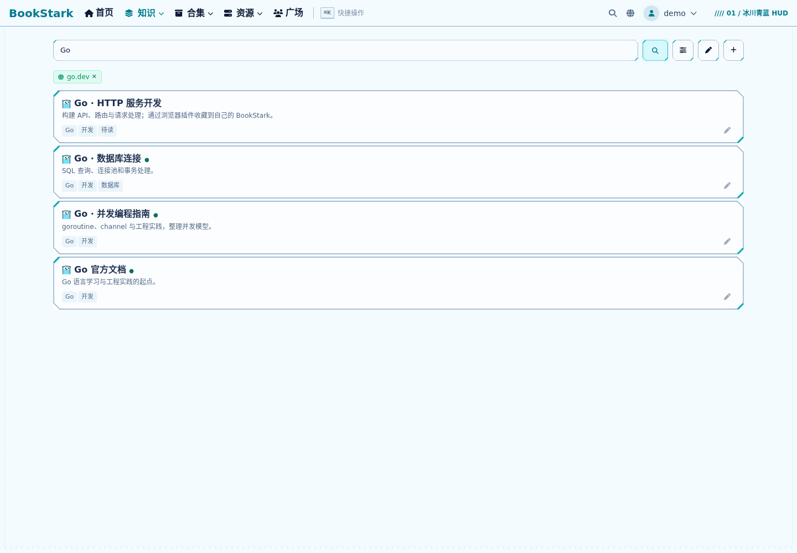</td>
  </tr>
</table>

这里的内容搜索针对**已保存的书签标题、网址和描述**，不会自动抓取并建立目标网页全文索引。给收藏补一句自己的摘要，会让以后查找更有效。

### 查到之后，直接批量整理

- **给收藏加上自己的理解**：编辑标题、网址、描述与标签，让链接成为有上下文的资料。
- **按查询结果成批操作**：逐条勾选，或全选当前筛选条件下的全部结果，再统一整理。
- **批量维护分类与状态**：添加/移除标签、置顶/取消置顶、公开/取消公开、加入/移出导航页，以及删除。
- **迁移已有收藏**：管理员可导入浏览器导出的书签 HTML，利用文件夹层级形成标签，并跳过同账号下重复的 URL。
- **维护长期可用的资料库**：管理员可批量检测失效链接，将无效书签清理到回收站；常用链接可放入导航页，公开链接可在广场展示。

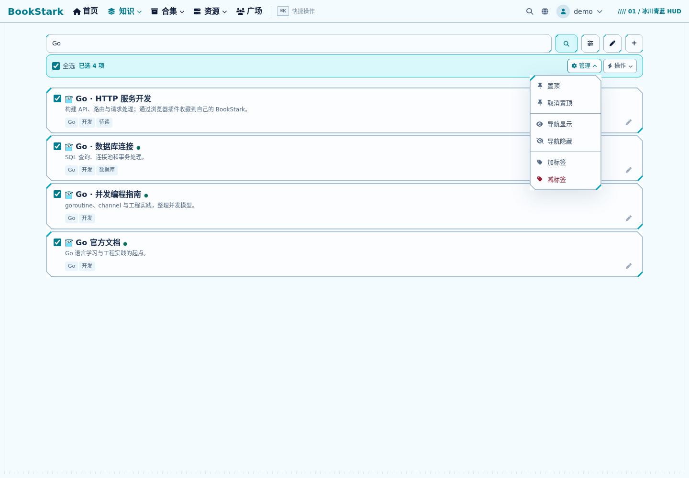

**一个实用的整理习惯：** 每周打开「无标签」书签，补充摘要并批量打标签；把常用资源置顶、加入导航，把愿意分享的资料设为公开。收藏不再只是越堆越长的列表。

### 浏览器插件：看到好内容，顺手存进自己的知识库

BookStark 提供 **Linkding 兼容 API**，可以连接开源的 [Linkding 浏览器扩展](https://github.com/sissbruecker/linkding-extension)。从浏览器到工作台，用的是同一个账号下的书签库。

- **快捷收藏当前网页**：点击扩展图标，或使用默认快捷键 `Alt + Shift + L`，填写标题、摘要和标签后保存。
- **在地址栏找回收藏**：输入 `ld`，按空格或 Tab 进入扩展搜索，再输入关键词，从建议结果直接打开已保存链接。
- **收藏时就完成整理**：扩展支持默认标签和标签建议；同账号重复保存相同 URL 时，BookStark 更新已有条目，便于补充说明与分类。
- **服务地址由你决定**：连接自己的 BookStark，用个人 API Token 授权；Token 可在个人设置中撤销。

<table>
  <tr>
    <td width="50%"><strong>连接自己的 BookStark</strong><br>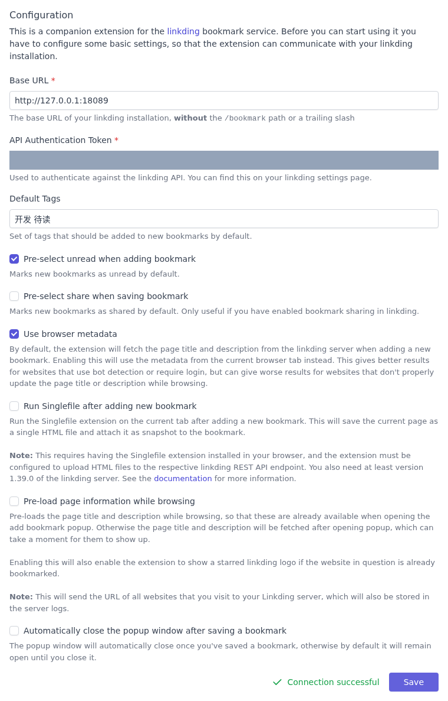</td>
    <td width="50%"><strong>收藏时填写摘要与标签</strong><br></td>
  </tr>
</table>

**接入只需三步：** 在「个人设置 → API Token」创建令牌 → 安装 [Chrome 扩展](https://chromewebstore.google.com/detail/linkding-extension/beakmhbijpdhipnjhnclmhgjlddhidpe) 或 [Firefox 扩展](https://addons.mozilla.org/zh-CN/firefox/addon/linkding-extension/) → 在扩展配置中填写 BookStark 根地址和 Token，保存并确认连接成功。

**公开状态提示：** 当前兼容接口将插件的 **Read later / unread** 映射为“不公开”；未勾选时保存为公开书签。插件的 Shared 选项不决定 BookStark 的公开状态，保存前请按这个映射核对。插件截图使用隔离的本地演示账号，收藏表单以独立扩展页打开拍摄；已验证实际保存与兼容接口查询。

配置、兼容范围和搜索示例见 [书签与浏览器插件指南](docs/bookmarks-and-browser-extension.md)。

## HTML 扩展平台：把想用的工具，装进同一个工作台

**知识库用来积累，HTML 工具用来动手。再加上 AI，你可以在同一个地方提出想法、生成工具、修改界面、保存成果并分享使用。**

BookStark 的 HTML 文章和文档可以承载 HTML、CSS 与 JavaScript，运行交互页面。一个计算器、一张数据看板、一套创作工作台，甚至直播播放器、街机游戏厅和 WebRTC 会议室，都可以成为知识库里可打开、可使用的内容。

### 从一句需求，到一个自己的工具

1. **描述需求**：新建 HTML 文章或文档，在编辑器中打开 AI，说明需要的页面、交互和样式；也可以导入或粘贴已有 HTML 工具代码。
2. **生成并预览**：让 AI 输出 HTML/CSS/JavaScript，应用到编辑器后查看实际运行效果。简单的浏览器工具不必另建项目、另配一套站点。
3. **继续用自然语言修改**：选中代码或带上现有内容，让 AI「增加 CSV 导出」「把布局改成适合手机」「给筛选器加一个重置按钮」，检查生成结果后应用。
4. **保存、组织、分享**：把工具与说明文档、使用笔记一起管理，按标签查找，再通过分享链接开放给他人使用。工具需要更新时，回到同一篇 HTML 内容继续编辑。

例如，你可以直接提出：

> 帮我做一个项目工时计算器，用 HTML、CSS 和 JavaScript 实现；支持添加任务、填写时长、自动汇总和导出 CSV，手机上也能用。
>
> 在现有工具上增加按项目筛选，保留已有数据和导出功能。

这是**编辑器里的 AI 生成与修改流程**：生成结果经过预览与确认后再使用。配置好 AI 服务即可开始；复杂工具仍需按功能接入资源或服务，并验证实际行为。

### 为什么放在 BookStark 里？

| 优势 | 带来的改变 |
| --- | --- |
| **工具和知识在一起** | 操作工具、记录过程、整理结果、分享说明，共用一个工作台入口，减少在零散站点间切换。 |
| **HTML 成为通用扩展入口** | 自己写的单页、AI 生成的小工具、可嵌入的 Web 应用，都有接入路径，不必为每个前端工具修改 Go 主程序。 |
| **按自己的需求持续修改** | 从现成页面开始，让 AI 帮忙增减功能、调整布局和优化交互，把通用工具变成自己的工具。 |
| **从个人使用到链接分享** | 同一份 HTML 内容既能自己使用，也能作为公开工具发布；说明、标签和访问入口一起管理。 |
| **一站式集成，按需扩展** | 记录、创作、AI、工具运行与分享连在一起；静态资源可通过 WebDAV 承载，需要后端的工具再接入相应服务。 |

这里的「接入任意工具」指开放的 Web/HTML 扩展方式：纯前端工具可以直接运行，第三方页面需允许嵌入，依赖后端、API 或本地程序的工具需要相应服务。工具内部的数据保存和权限以各工具实现为准。

### 案例一：Craft 系列，把专业创作工具汇集到工作台

从文档、表格、演示到图像、设计、工程制图和材质创作，Craft 系列展示了同一 HTML 入口可以覆盖多种工作场景。下面是已经接入站点的实际界面。

<table>
  <tr>
    <td width="50%"><strong>CADCraft · 工程制图</strong><br>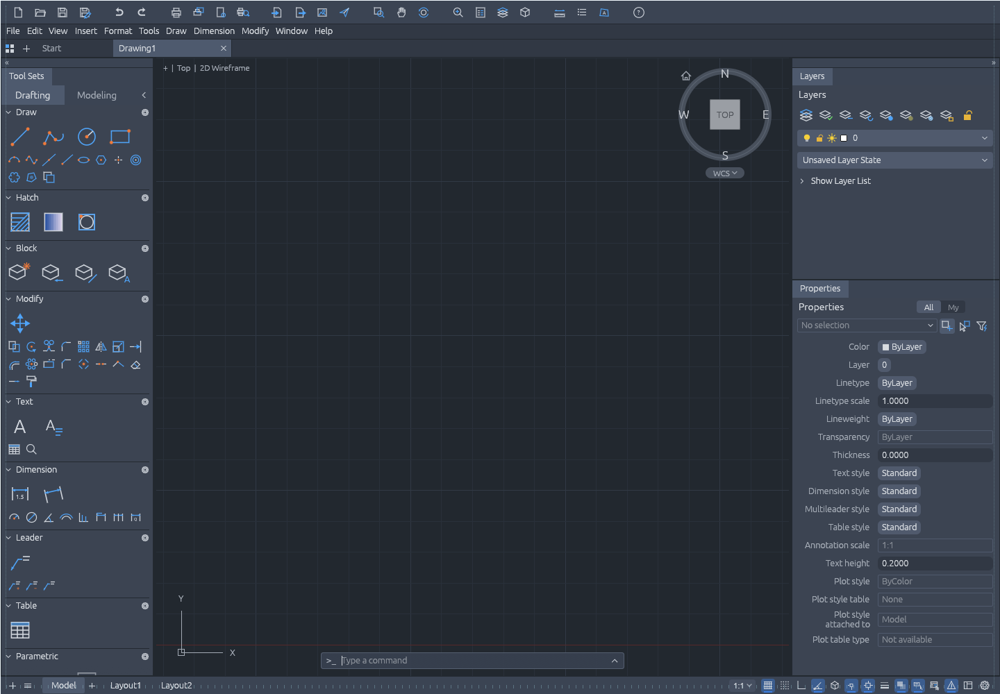</td>
    <td width="50%"><strong>DeckCraft · 演示文稿</strong><br>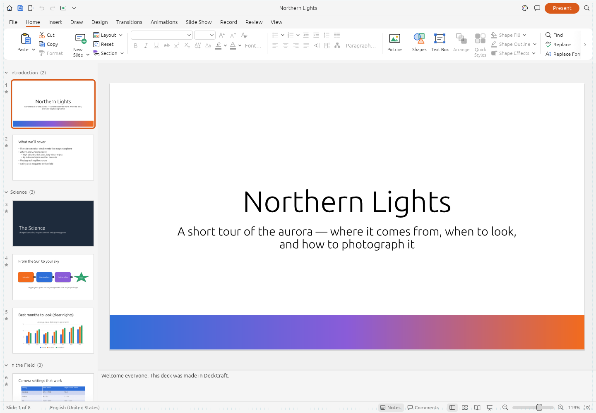</td>
  </tr>
  <tr>
    <td><strong>MaterialCraft · 节点材质</strong><br></td>
    <td><strong>TextureCraft · 3D 纹理</strong><br></td>
  </tr>
</table>

<details>
<summary><strong>展开查看更多 Craft 工具：文档、表格、演示、图像、音视频与设计</strong></summary>

<table>
  <tr><td width="50%"><strong>WordCraft · 文档</strong><br>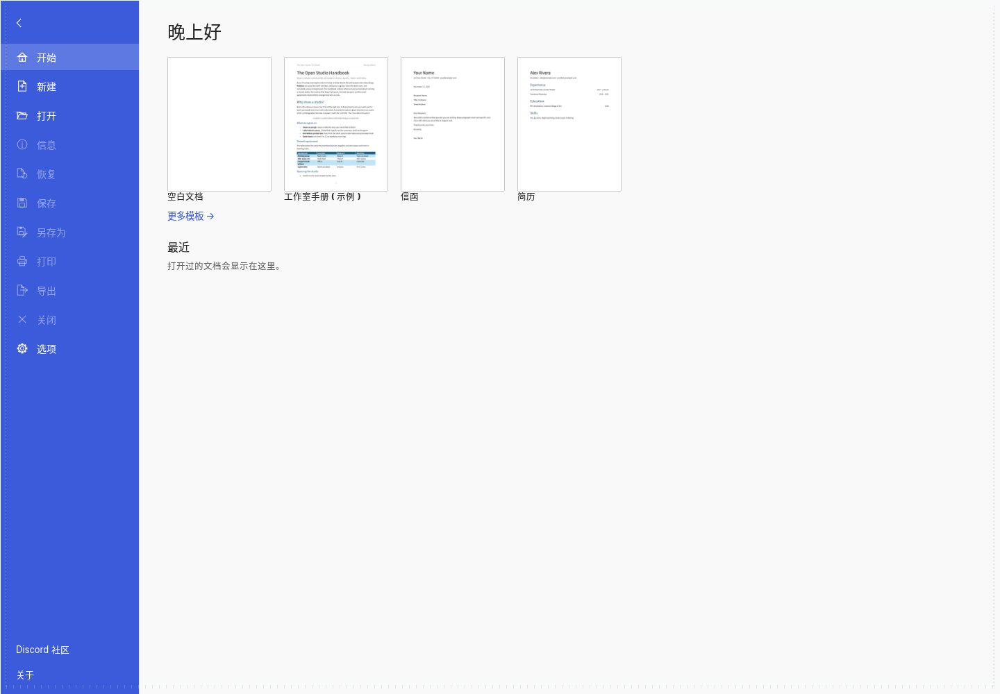</td><td width="50%"><strong>GridCraft · 表格</strong><br></td></tr>
  <tr><td><strong>FigCraft · 界面设计</strong><br></td><td><strong>PhotoCraft · 图片编辑</strong><br></td></tr>
  <tr><td><strong>VectorCraft · 矢量设计</strong><br></td><td><strong>DesignCraft · 版式设计</strong><br>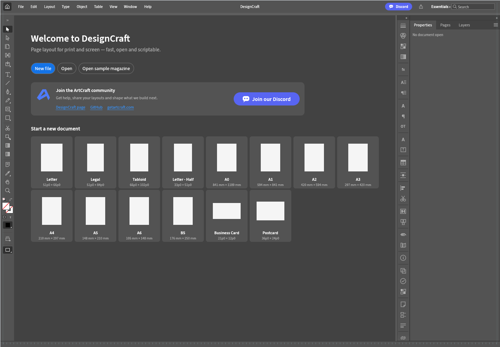</td></tr>
  <tr><td><strong>FilmCraft · 视频剪辑</strong><br></td><td><strong>SoundCraft · 音频制作</strong><br></td></tr>
  <tr><td><strong>EffectCraft · 动效</strong><br></td><td><strong>LightCraft · 照片与 RAW</strong><br>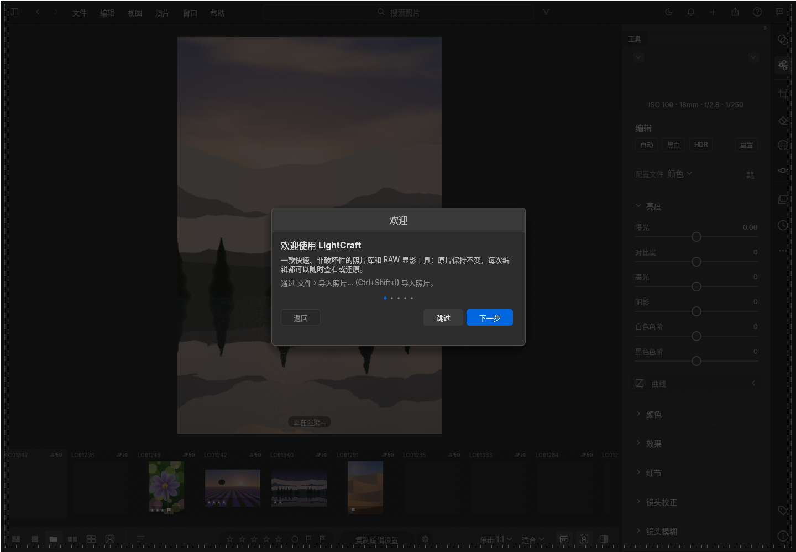</td></tr>
  <tr><td><strong>PdfCraft · PDF</strong><br>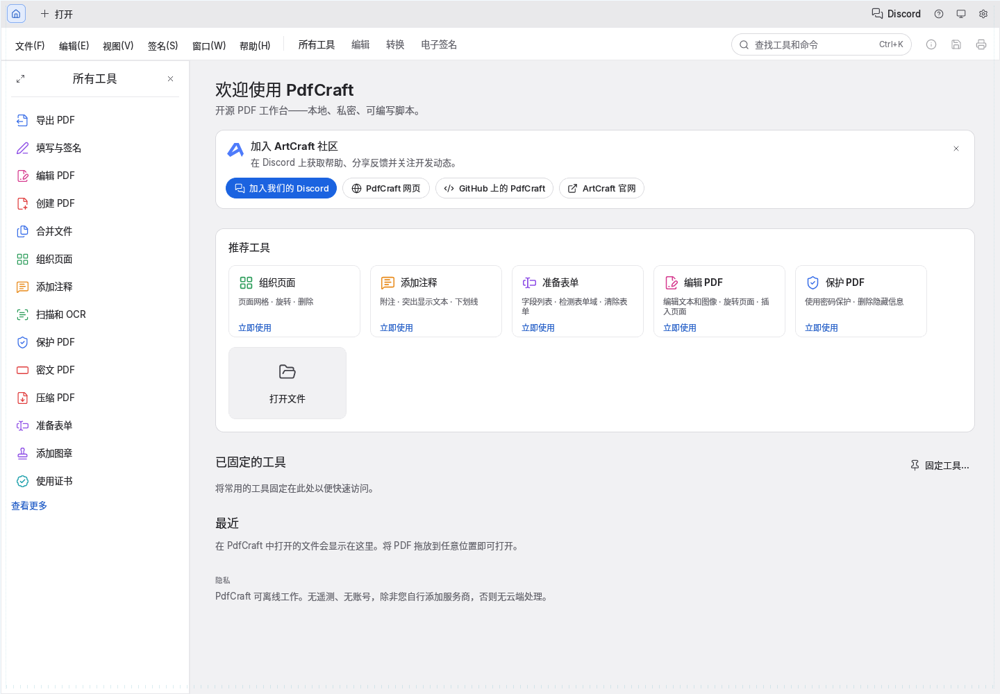</td><td><strong>Craft Anything · 文件识别</strong><br>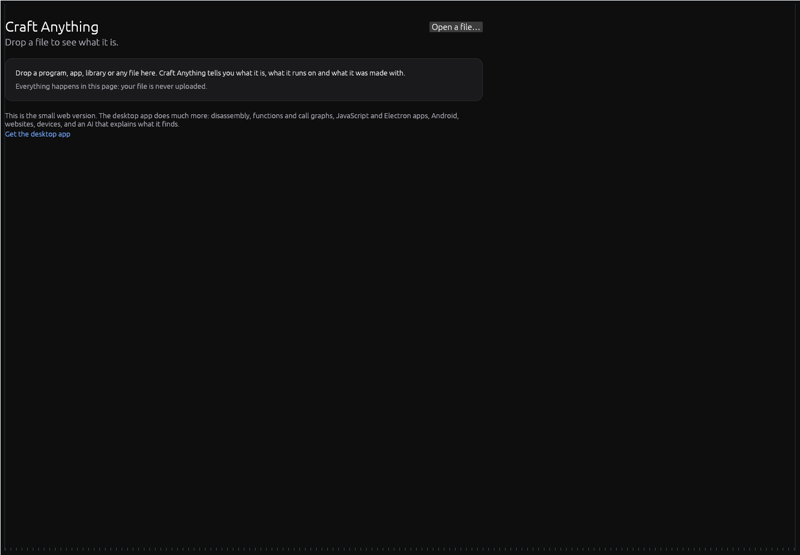</td></tr>
</table>

</details>

**适用场景：** 在同一个入口打开设计稿、编写说明、整理表格，再把操作心得沉淀为文章。这里展示的是已接入的工具界面，各工具的功能范围、资源依赖和授权以其自身实现为准。

### 案例二：电视直播，把频道变成可分享的工具页面

国内直播与世界电视分别提供频道浏览和播放入口。把常看的内容集中到自己的门户，打开链接即可进入，不用为每个频道维护一张独立书签。

<table>
  <tr>
    <td width="50%"><strong>电视直播 · CCTV-1 实际播放</strong><br></td>
    <td width="50%"><strong>世界电视 · 美国 Biz TV 实际播放</strong><br></td>
  </tr>
</table>

两张截图分别为 **CCTV-1 综合频道**和**美国 Biz TV** 的实际播放画面，拍摄前已确认视频持续播放。频道来自所配置的直播源，实际可用性受源站和网络影响。

### 案例三：街机游戏厅，让 HTML 承载完整的交互应用

街机游戏厅将浏览器模拟器、游戏选择和运行控制整合到一个页面，支持键盘、手柄与触屏操作，以及工具支持的存档导入导出。它展示了 HTML 扩展也能承载 WebAssembly 等复杂浏览器应用。

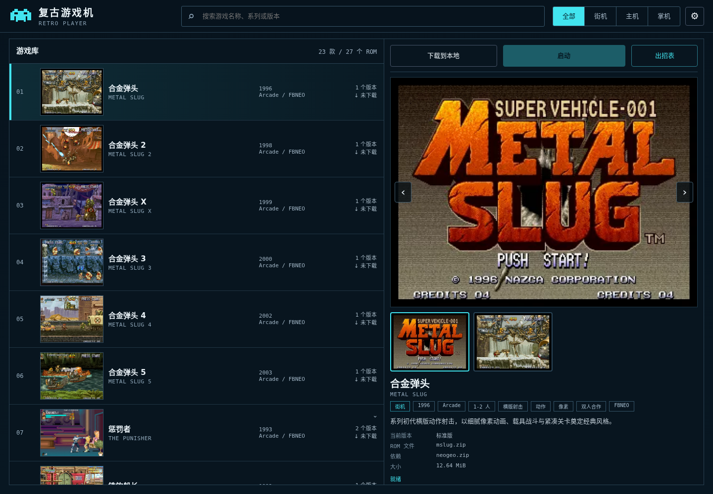

模拟器资源按需加载；游戏与 BIOS 需自行提供有权使用的文件，不随 BookStark 发布包分发。接入说明见 [Retro Player](integrations/retro-player/README.md)。

### 案例四：WebRTC 会议室，把交流和协作也放进工作台

一个 HTML 分享入口，承载房间创建与加入、屏幕和摄像头共享、实时标注等协作能力。讲解设计稿、远程演示工具、一起看资料，都可以围绕同一张协作画布展开。


浏览器媒体权限、信令和网络连通性按实际部署配置。图中为会议入口，不代表正在进行多人通话。

### 更多公开 HTML 实例：45 个实例的完整展示

截至 2026-11-22，广场公开的 **45 篇 HTML 文章**均已配图：前文展示 Craft、电视、游戏厅与会议室，下面补齐其余 25 个实例。这里只展示名称与实际界面，不提供线上实例地址。截图是拍摄时的界面；需要摄像头、麦克风、本地文件或协作对象的工具展示入口，不代表已经授权设备或建立连接。

<details open>
<summary><strong>办公与内容创作</strong></summary>

<table>
  <tr>
    <td width="50%"><strong>PDF 工作台：本地 PDF 阅读、批注与页面整理</strong><br></td>
    <td width="50%"><strong>PPTist：在线演示文稿工作台</strong><br></td>
  </tr>
  <tr>
    <td width="50%"><strong>电子表格工具</strong><br>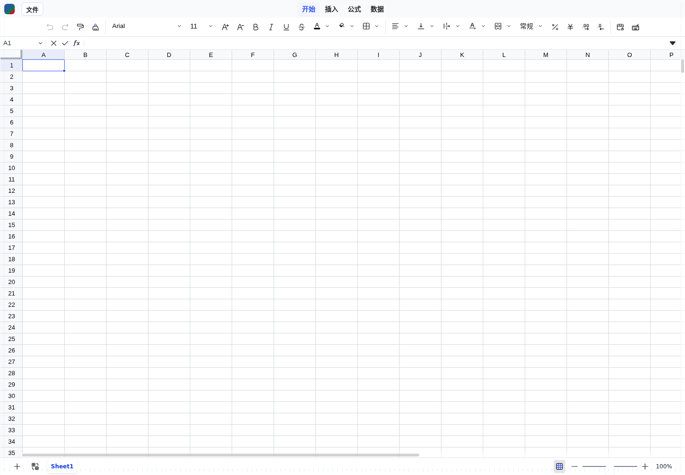</td>
    <td width="50%"><strong>docx文档编辑器</strong><br>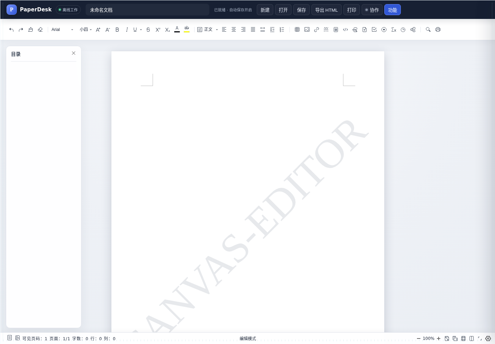</td>
  </tr>
  <tr>
    <td width="50%"><strong>简历排版工作台</strong><br></td>
    <td width="50%"><strong>画板</strong><br>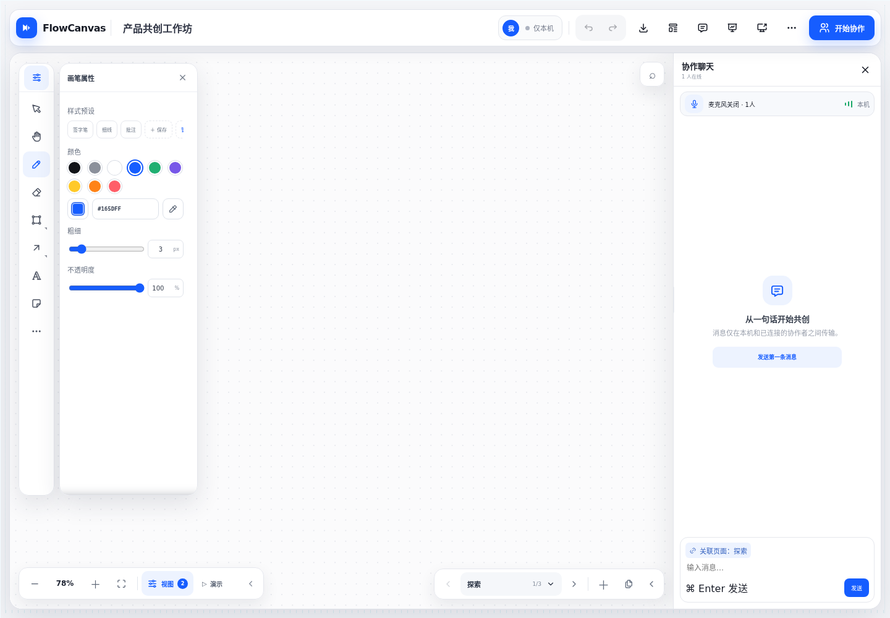</td>
  </tr>
  <tr>
    <td width="50%"><strong>prompt管理工具</strong><br>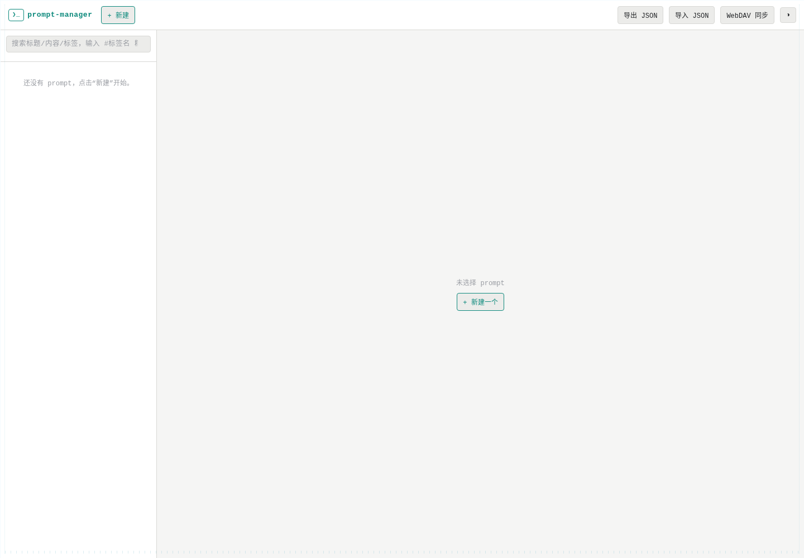</td>
    <td width="50%"><strong>知识卡片</strong><br></td>
  </tr>
</table>

</details>

<details open>
<summary><strong>图像、摄影与音频</strong></summary>

<table>
  <tr>
    <td width="50%"><strong>时间冻结摄影棚</strong><br></td>
    <td width="50%"><strong>人声效果器</strong><br>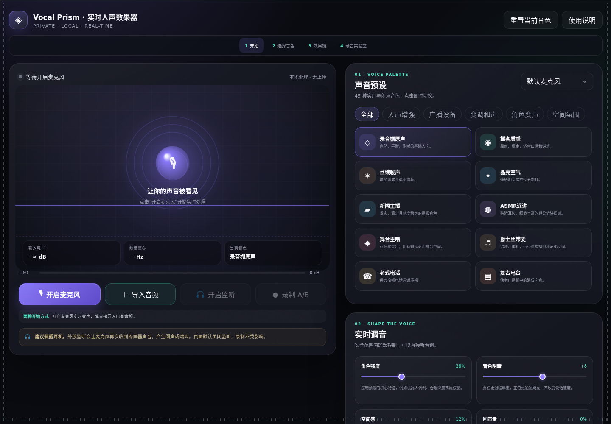</td>
  </tr>
  <tr>
    <td width="50%"><strong>图片效果工厂</strong><br>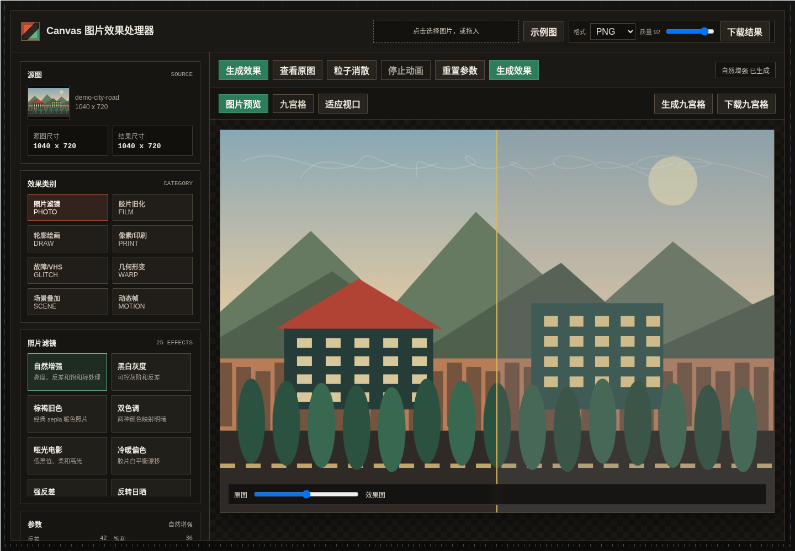</td>
    <td width="50%"><strong>摄像头实验室</strong><br></td>
  </tr>
  <tr>
    <td width="50%"><strong>暗房工具箱</strong><br></td>
    <td width="50%"><strong>图片文字隐写工具</strong><br></td>
  </tr>
</table>

</details>

<details open>
<summary><strong>学习与投资演示</strong></summary>

<table>
  <tr>
    <td width="50%"><strong>K线技术术语教学</strong><br>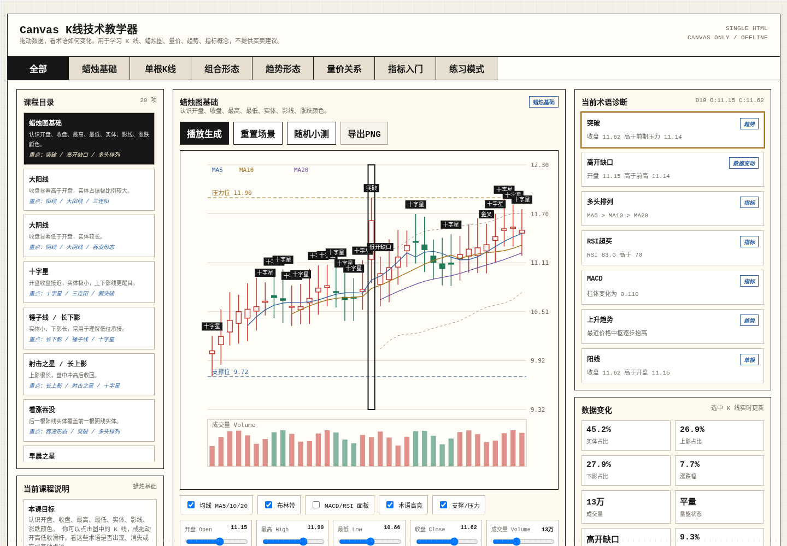</td>
    <td width="50%"><strong>道德经研习录：81章互动学习地图</strong><br></td>
  </tr>
  <tr>
    <td width="50%"><strong>选股决策台</strong><br></td>
    <td width="50%"><strong>简单的交易模拟器</strong><br>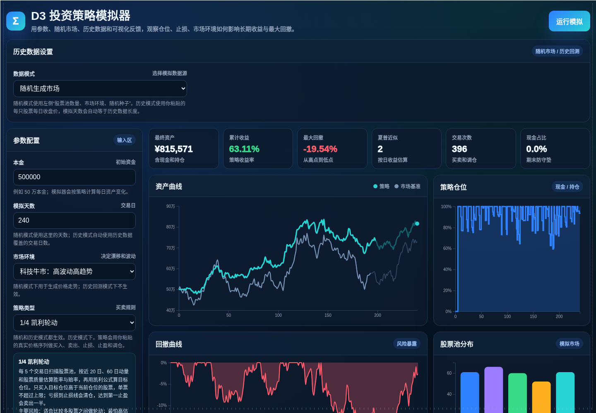</td>
  </tr>
  <tr>
    <td width="50%"><strong>投资底层逻辑</strong><br>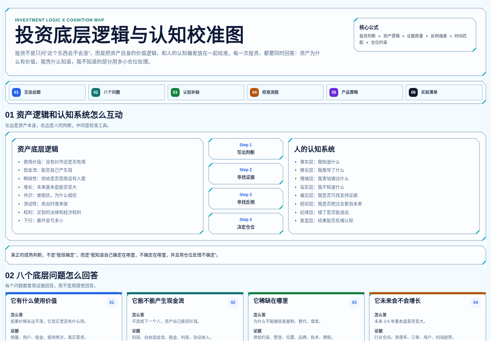</td>
    <td width="50%"><strong>股票交易决策地图</strong><br>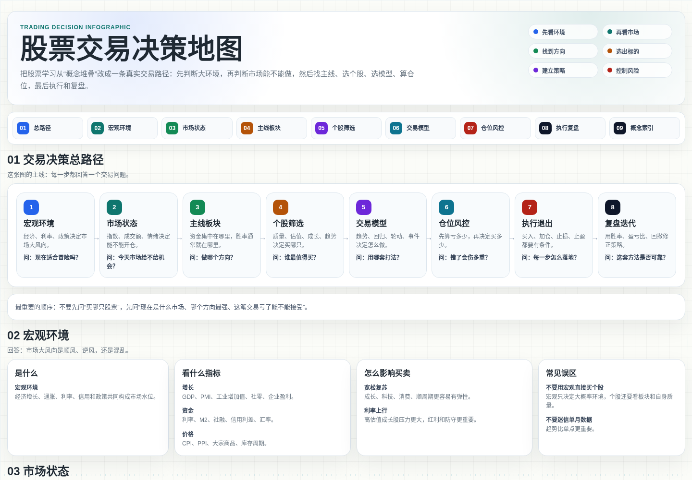</td>
  </tr>
  <tr>
    <td width="50%"><strong>凯利投资模拟</strong><br></td>
  </tr>
</table>

</details>

<details open>
<summary><strong>电台、协作与实用工具</strong></summary>

<table>
  <tr>
    <td width="50%"><strong>收音机</strong><br></td>
    <td width="50%"><strong>书签星图：Canvas 书签档案馆</strong><br></td>
  </tr>
  <tr>
    <td width="50%"><strong>airdrop文件分享助手</strong><br></td>
    <td width="50%"><strong>二维码生成</strong><br>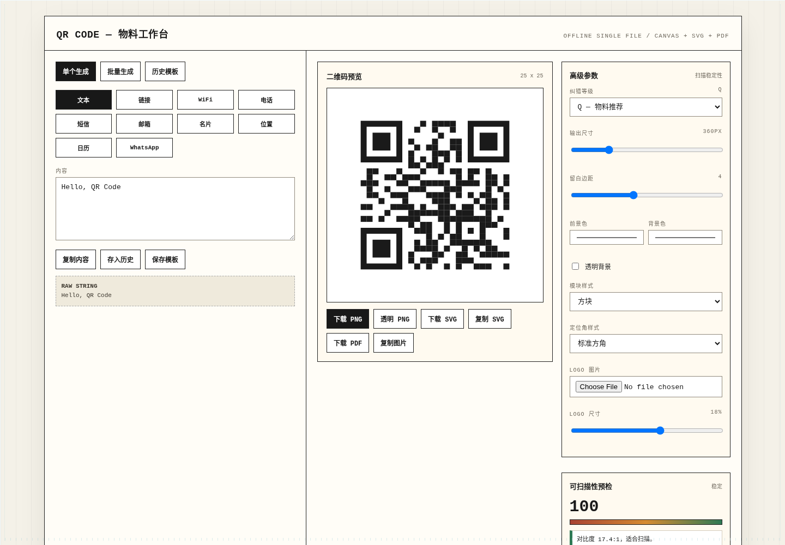</td>
  </tr>
</table>

</details>

全部实例也可在 [HTML 实例截图目录](docs/html-examples.md) 中按分类浏览。

> 以上为公开站点实际接入案例，不代表安装 BookStark 后自动附带全部工具、媒体源和第三方资源。BookStark 提供 HTML 编辑、运行与分享的基础，让你按自己的需求搭出一站式工作台。

## 访问统计与管理后台：把站点运营也放进工作台

**不仅管理内容，也能了解访问、管理成员、维护自己的站点。** 从个人资料库到面向读者的分享站，常用管理能力都有可视化入口。

### 访问统计：看看内容发布后的访问变化

管理员打开「访问统计」，可以切换 **24 小时、7 天、30 天、90 天**范围，查看总访问量、IP 指标和 PV / UV 趋势；下方的最近访问列表展示时间、路径、IP，以及登录账号或游客身份。把趋势与最近访问放在一起，便于观察分享入口和书签页的访问情况。


> 统计截图使用独立演示数据，不代表真实运营流量。当前记录首页 `/`、广场及分享页 `/shares*`、书签页 `/bookmarks*` 的访问；趋势基于日汇总，跨日「独立 IP」为每日去重 IP 数之和，不是整个区间去重人数。「最近访问」保留每个 IP 与账号组合的最新记录，不是逐次请求审计日志。

### 管理员后台：成员、配置、数据各有入口

| 管理事项 | 可以做什么 |
| --- | --- |
| **用户管理** | 查看成员与审批状态，通过或拒绝注册申请，设置或取消管理员角色，重置成员密码。 |
| **系统参数** | 设置未登录访客默认主题、登录与分页选项、导航与编辑器参数，以及媒体、邮件、邀请码等配置。 |
| **内容与服务配置** | 管理分享评论、电视直播频道和新闻源，并配置 AI 助手。 |
| **数据管理** | 按全站或指定用户导出数据，可包含上传的图片与附件；导入备份、导入浏览器书签、清理失效书签，并单独备份 WebDAV 文件数据库。 |


<table>
  <tr>
    <td width="50%"><strong>系统参数 · 统一配置站点</strong><br>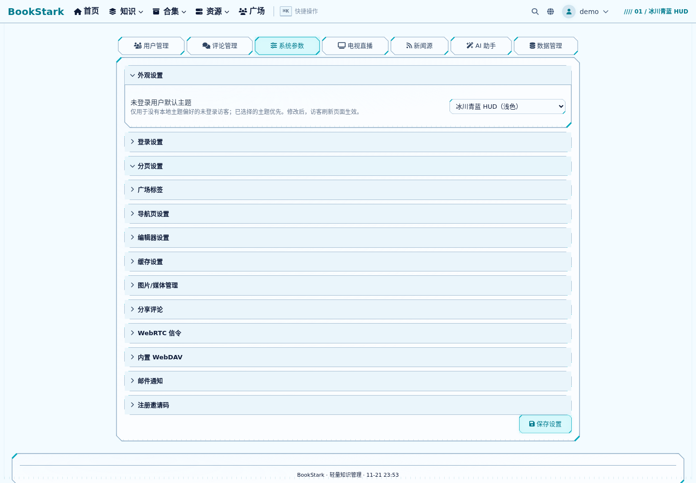</td>
    <td width="50%"><strong>数据管理 · 导出、导入与迁移</strong><br>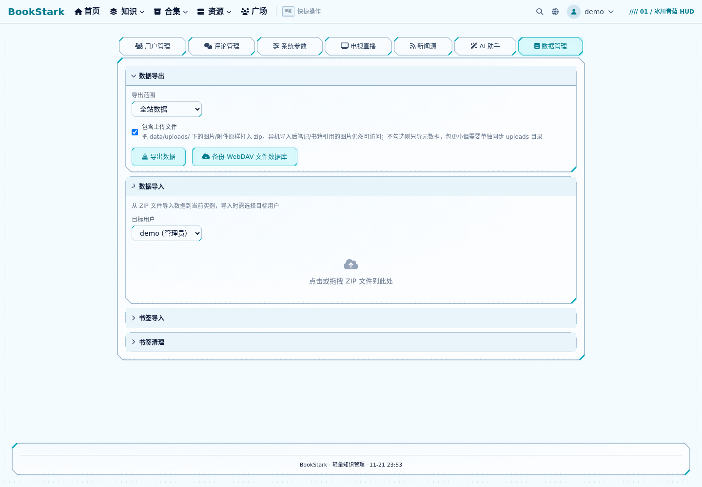</td>
  </tr>
</table>

**自己维护站点，也能带走数据。** 用户与系统管理、访问统计均有管理员权限限制；截图来自本地演示环境，未展示线上成员资料或服务凭据。

## 六套主题，让工作台有自己的性格

想要清爽、克制、玻璃质感，还是科幻电影里的控制台？在「个人设置 → 用户主题」里切换即可。

<table>
  <tr>
    <td width="50%"><strong>冰川青蓝 HUD · 浅色</strong><br>冰白底色、深蓝文字、青色细线与切角面板。<br></td>
    <td width="50%"><strong>青蓝航空 HUD · 深色</strong><br>深海蓝底色、青蓝线框与仪表式信息层级。<br></td>
  </tr>
  <tr>
    <td><strong>玻璃</strong><br>玻璃边缘与层次感，给日常工作多一点质感。<br></td>
    <td><strong>NVIDIA</strong><br>深色界面搭配绿色强调，鲜明而专注。<br>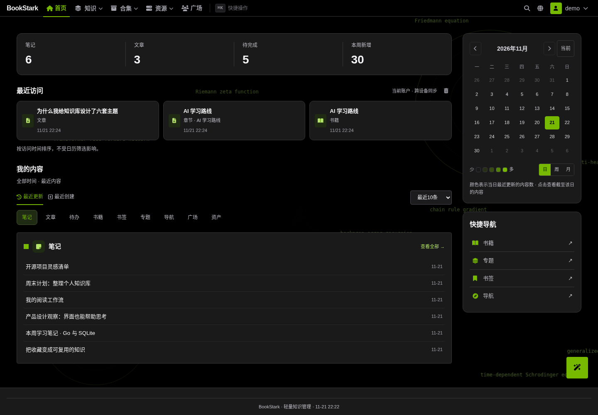</td>
  </tr>
  <tr>
    <td><strong>Apple</strong><br>浅色、中性灰与蓝色强调，简洁耐看。<br></td>
    <td><strong>默认</strong><br>清晰、轻快的经典浅色工作界面。<br></td>
  </tr>
</table>

主题选择保存在当前浏览器，刷新后保留，并支持同一浏览器的跨标签页同步。管理员还可以在「系统设置 → 系统参数 → 外观设置」指定**未登录用户默认主题**：访客已有的浏览器主题偏好优先，已登录用户不受此默认值影响。

## 功能全景

| 你想做什么 | BookStark 提供什么 |
| --- | --- |
| 随时记录与整理 | 速记、文章、Markdown / HTML、标签、置顶、搜索与分享 |
| 建立系统知识 | 书架、书籍、层级文档目录与阅读入口 |
| 围绕问题做研究 | 专题详情、关联资料、小结、待办与评论 |
| 让计划变成行动 | 待办、子任务、完成状态、日期与提醒设置 |
| 收藏、查询与整理链接 | 浏览器插件收藏、地址栏搜索、标题/网址/描述搜索、标签 AND/OR、站点/时间/状态筛选、批量管理与导航页 |
| 让 AI 帮忙梳理 | 首页助手、文字资料检索、Markdown 总结、笔记与待办草稿确认创建、编辑器辅助 |
| 写文章之外也能创作 | 富文档、电子表格、画板、思维导图、演示文稿，以及无需登录的本机创作工具 |
| 扩展自己的工具平台 | HTML 工具编辑与运行、AI 生成与修改、分享发布；可接入 Craft、直播、街机和 WebRTC 等工具 |
| 发布自己的内容 | 公开广场、文章/速记/书籍/书签浏览、分享链接与评论 |
| 管理文件和图片 | 图片管理、本地 WebDAV 文件服务、文件上传、浏览与管理 |
| 管理服务器 | 管理员专用的 SSH 资产、网页终端、凭据、远程文件与 Docker 管理 |
| 打造个人门户 | 新闻资讯、电台、世界时钟、友情链接与社交二维码 |
| 维护自己的站点 | 用户管理、统计看板、系统设置、数据导入导出与回收站 |

## 从记录到输出，一条完整的工作流

### 1. 先把想法留下来

打开笔记，把灵感、学习摘要和工作记录写下来。用标签聚类，用日历回看；需要展开时，再写成一篇完整文章。


<details>
<summary><strong>展开查看文章列表</strong></summary>


</details>

### 2. 用书籍搭体系，用专题连资料

一本书沉淀长期知识，一个专题推进一个问题。把笔记、文章、文档、书签和待办关联起来，资料、判断与行动都有位置。


<table>
  <tr>
    <td width="50%"><strong>自己的知识书架</strong><br></td>
    <td width="50%"><strong>目录与编辑预览</strong><br>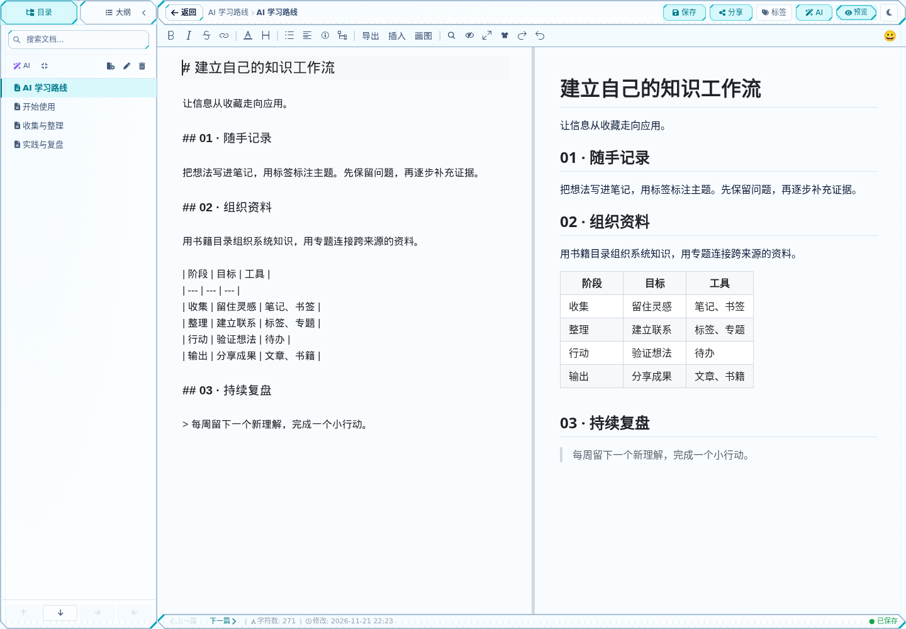</td>
  </tr>
</table>

### 3. 让收藏和计划真正用起来

把有价值的链接放进书签，为它写下自己的摘要。再用待办把「以后再看」拆成可以完成的一步。

<table>
  <tr>
    <td width="50%"><strong>书签与标签</strong><br></td>
    <td width="50%"><strong>待办与日期</strong><br></td>
  </tr>
</table>

### 4. 把 AI 带到自己的资料旁边

在首页打开助手，围绕当前账号的资料提问、查找和总结。也可以让它起草一条笔记或待办，**检查草稿、点击确认，再创建记录**。

- 接入支持工具调用的 **OpenAI 兼容接口 / Anthropic 接口**，无需额外向量数据库。
- 流式显示回答和处理进度，支持停止、来源链接与会话恢复。
- 检索范围按账号隔离；当前正文读取支持 Markdown，密码保护内容与服务器凭据不提供给助手。
- AI 服务需自行配置；请求和检索到的相关内容会发往所选服务，调用可能产生费用。

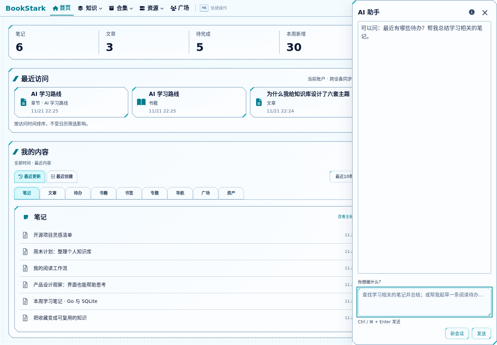

图中展示助手入口与实际面板，不包含模拟的 AI 回答。能力范围与配置细节见 [AI 助手说明](docs/usage-and-deployment.md#首页-ai-助手第一版)。

### 5. 继续创作，也可以分享出去

无需登录也能打开本机创作工具：**Markdown、富文档、电子表格、画板、思维导图、演示文稿**。本机草稿自动保存到当前浏览器，支持导入与导出。

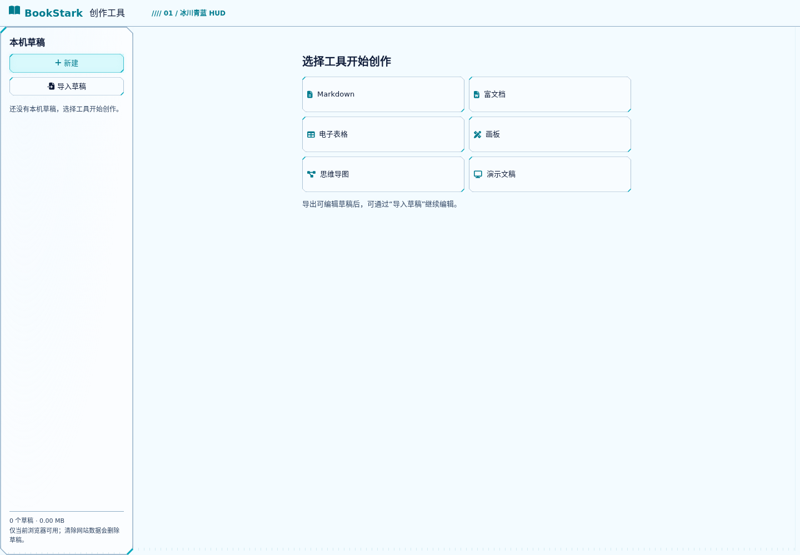

想展示成果？把公开内容汇集到广场，让访客按栏目浏览、搜索与阅读。


本机草稿与账号内容分开存储，换设备不会自动同步本机草稿。详见 [本机创作工具说明](docs/local-creation-tools.md)。

## 手机，也是一张完整工作台

用手机记录灵感、查看笔记、处理专题。支持 PWA 安装，常用入口可以放到主屏幕。

<p align="center">
  
  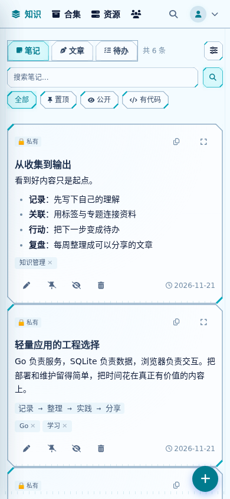
  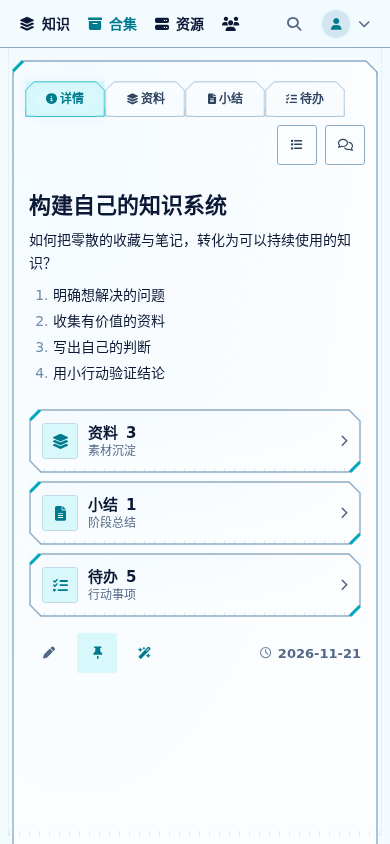
</p>

PWA 提供静态缓存与部分离线能力；登录、AI、服务器操作等需要网络，并非所有功能都可离线使用。

## 快速部署

**准备 Docker，在自己的机器上从源码启动。** 以下示例使用 Bash、Git 与 OpenSSL，数据持久化到当前目录的 `data/`。

```bash
git clone https://github.com/yunwan1x/bookstark.git
cd bookstark

# 首次生成并保存密钥；后续升级请保留同一份文件。
umask 077
mkdir -p data
cat > data/bookstark.env <<EOF
PORT=8089
MODE=release
TZ=Asia/Shanghai
DB_PATH=/data/bookstark.db
WEBDAV_DB_PATH=/data/bookstark-webdav.db
JWT_SECRET=$(openssl rand -hex 32)
BOOKSTARK_ASSET_SECRET=$(openssl rand -hex 32)
ADMIN_ACCOUNT=admin
ADMIN_PASSWORD=$(openssl rand -hex 16)
EOF

# 构建与启动
DOCKER_BUILDKIT=1 docker build -t bookstark:local .
docker run -d --name bookstark --restart unless-stopped \
  -p 127.0.0.1:8089:8089 \
  --env-file data/bookstark.env \
  -w /data -v "$(pwd)/data:/data" \
  bookstark:local

# 查看首次初始化的管理员密码
sed -n 's/^ADMIN_PASSWORD=//p' data/bookstark.env
```

访问 **http://localhost:8089**，使用 `admin` 和生成的密码登录。远程访问请配置 HTTPS 反向代理，并支持 WebSocket 与 SSE。

桌面和 Android 用户可从 [GitHub Releases](https://github.com/yunwan1x/bookstark/releases) 下载 GUI 客户端，选择本地工作区或连接远程服务器。macOS 请按芯片选择 `macos-arm64`（Apple Silicon）或 `macos-amd64`（Intel），两者为独立安装包。本地首次初始化时自行设置 admin 密码，并可在创建完成页复制密码。Release 同时提供独立服务端二进制（Linux、macOS、Windows 的 amd64/arm64），解压后运行即可通过浏览器访问，无需 GUI 或 Docker。服务器也可使用 Docker 镜像部署。完整的 Docker Compose 示例、GHCR 镜像、环境变量、本地运行、升级和备份方法见 [部署与维护手册](docs/usage-and-deployment.md)。请使用手册中的 BookStark Compose 示例；开发机代理工具单独放在 `tools/dev-proxy/`。

> 升级前备份数据库、上传文件与密钥。首次生成的环境文件不要提交到 Git，也不要在升级时重新生成；已有账号密码不会因初始化环境变量改变。

## 技术与开放性

| 层级 | 选择 |
| --- | --- |
| 服务端 | Go + Gin + Go HTML Templates |
| 数据 | SQLite，无需独立数据库服务 |
| 界面 | JavaScript、Tailwind CSS、CSS 变量与共享组件 |
| 分发 | Docker、嵌入式静态资源与模板、发布工作流 |
| 接入 | API Token、WebDAV、OpenAI 兼容 / Anthropic AI 接口 |
| 许可 | Apache License 2.0；第三方组件遵循各自许可 |

[部署与维护](docs/usage-and-deployment.md) · [创作工具](docs/local-creation-tools.md) · [资讯源](docs/news-feeds.md) · [仓库结构](docs/repository-layout.md) · [测试指南](tests/README.md) · [开发约定](CLAUDE.md) · [辅助脚本](scripts/README.md)

## 一起把 BookStark 做得更好

如果 BookStark 正好解决了你的需求，**欢迎点一颗 ⭐ Star**。这是收藏项目最简单的方式，也能帮助更多自托管和知识管理爱好者发现它。

- **试用并反馈**：把使用场景、复现步骤和截图带到 [Issues](https://github.com/yunwan1x/bookstark/issues)。
- **分享你的工作台**：展示主题搭配、知识组织方式或自托管经验。
- **参与贡献**：文档、翻译、功能和问题修复都欢迎；较大的改动建议先在 Issue 中讨论。

### Star 趋势

<a href="https://www.star-history.com/#yunwan1x/bookstark&Date">
  <picture>
    <source media="(prefers-color-scheme: dark)" srcset="https://api.star-history.com/svg?repos=yunwan1x/bookstark&amp;type=Date&amp;theme=dark">
    <source media="(prefers-color-scheme: light)" srcset="https://api.star-history.com/svg?repos=yunwan1x/bookstark&amp;type=Date">
    
  </picture>
</a>

趋势图由 [Star History](https://github.com/star-history/star-history) 提供；加载受其服务与缓存影响，点击图片可查看交互图表。

---

<div align="center">

**让每一次记录，都成为下一次创造的起点。**<br>
[⭐ Star BookStark](https://github.com/yunwan1x/bookstark) · [下载发布版](https://github.com/yunwan1x/bookstark/releases) · [反馈问题](https://github.com/yunwan1x/bookstark/issues)

</div>
