<div align="center">

# BookStark

### 把灵感、知识与行动，装进自己的工作台。

**自托管知识管理 · AI 助手 · 多格式创作 · 六套主题 · Go + SQLite**

一个地方，完成记录、整理、阅读、创作与分享。<br>
从随手记下一个想法，到建立一本知识手册，再到管理自己的服务器。

[](https://github.com/yunwan1x/bookstark/stargazers)
[](https://github.com/yunwan1x/bookstark/releases)
[](go.mod)
[](docs/usage-and-deployment.md)
[](LICENSE)

[快速部署](#快速部署) · [功能全景](#功能全景) · [六套主题](#六套主题让工作台有自己的性格) · [截图导览](#从记录到输出一条完整的工作流) · [参与贡献](#一起把-bookstark-做得更好)

**喜欢这个方向？点亮右上角的 ⭐ Star，让更多人发现 BookStark。**

</div>

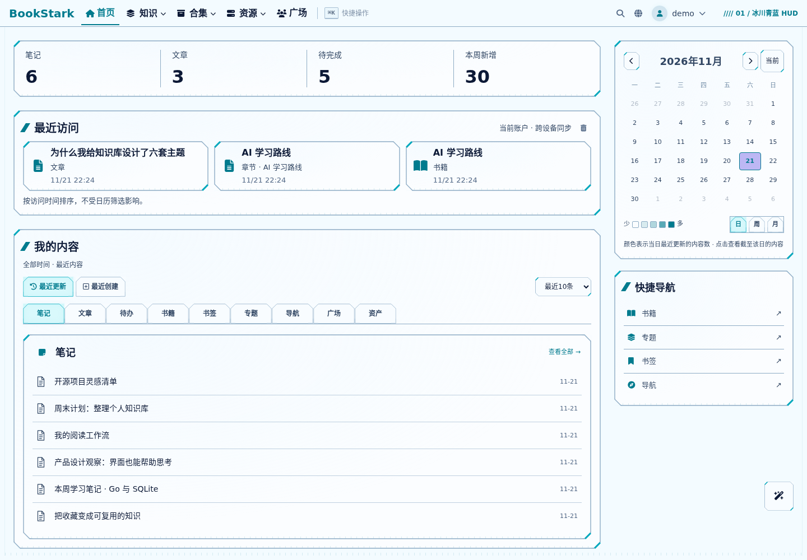

> 上图及下方界面图均来自实际运行的 BookStark，使用独立演示数据拍摄。点击图片可查看大图。

## 为什么值得放进你的自托管清单？

- **让知识有去处，也有下一步。** 笔记捕捉灵感，书签积累资料，书籍建立体系，专题串联问题，待办推动行动。
- **一个工作台，覆盖多种创作方式。** Markdown、HTML、富文档、电子表格、画板、思维导图、演示文稿，在熟悉的界面里切换。
- **AI 可以围绕你的资料工作。** 检索当前账号的文字资料、读取与总结 Markdown 正文、起草笔记和待办；确认草稿后再创建。
- **数据与部署自己掌握。** Go 后端与 SQLite，无需单独部署数据库服务；支持 Docker，生产构建可将前端资源与模板嵌入二进制。
- **从个人知识库延伸到开发者工作台。** 书签、文件、WebDAV 与管理员专用的 SSH、远程文件、Docker 管理，共用一个入口。
- **每天打开，也要看得舒服。** 六套独立主题、中文/英文、桌面与手机布局、PWA 安装，兼顾内容密度与使用体验。

**适合你，如果你想要：** 一个自己的知识库、一套学习与研究工作流、一个自托管内容站，或一张把资料与工具放在一起的开发者工作台。

## 六套主题，让工作台有自己的性格

想要清爽、克制、玻璃质感，还是科幻电影里的控制台？在「个人设置 → 用户主题」里切换即可。

<table>
  <tr>
    <td width="50%"><strong>冰川青蓝 HUD · 浅色</strong><br>冰白底色、深蓝文字、青色细线与切角面板。<br></td>
    <td width="50%"><strong>青蓝航空 HUD · 深色</strong><br>深海蓝底色、青蓝线框与仪表式信息层级。<br>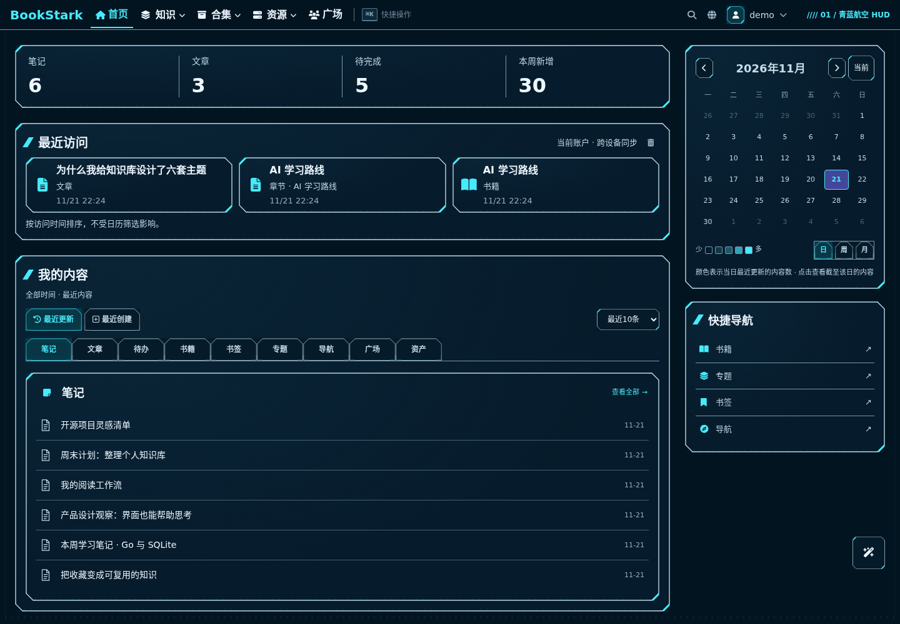</td>
  </tr>
  <tr>
    <td><strong>玻璃</strong><br>玻璃边缘与层次感，给日常工作多一点质感。<br>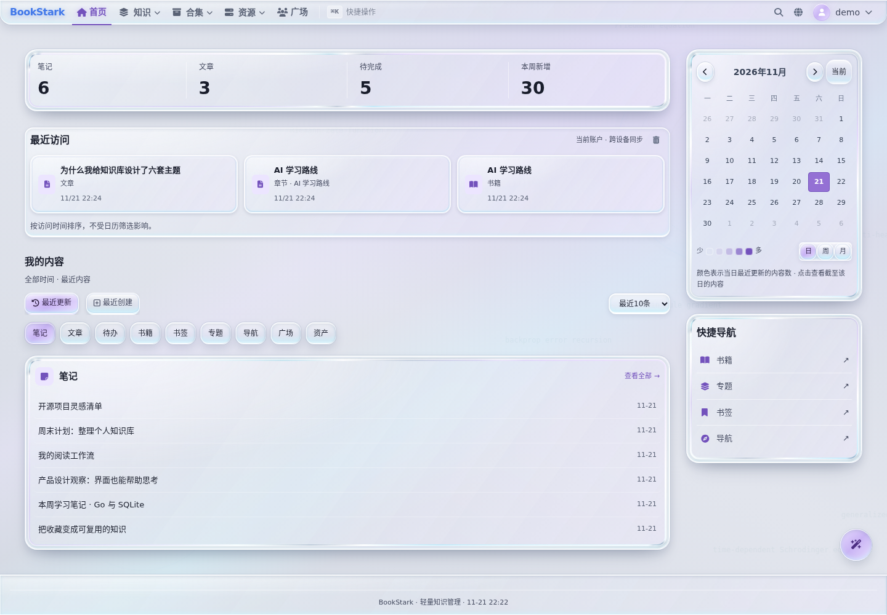</td>
    <td><strong>NVIDIA</strong><br>深色界面搭配绿色强调，鲜明而专注。<br></td>
  </tr>
  <tr>
    <td><strong>Apple</strong><br>浅色、中性灰与蓝色强调，简洁耐看。<br>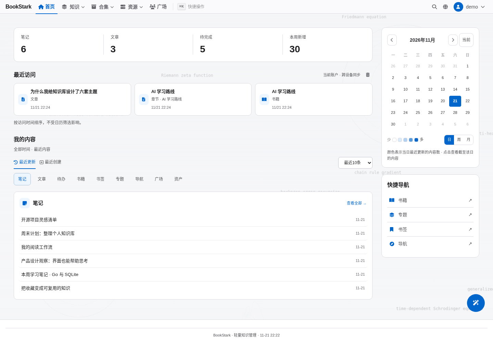</td>
    <td><strong>默认</strong><br>清晰、轻快的经典浅色工作界面。<br>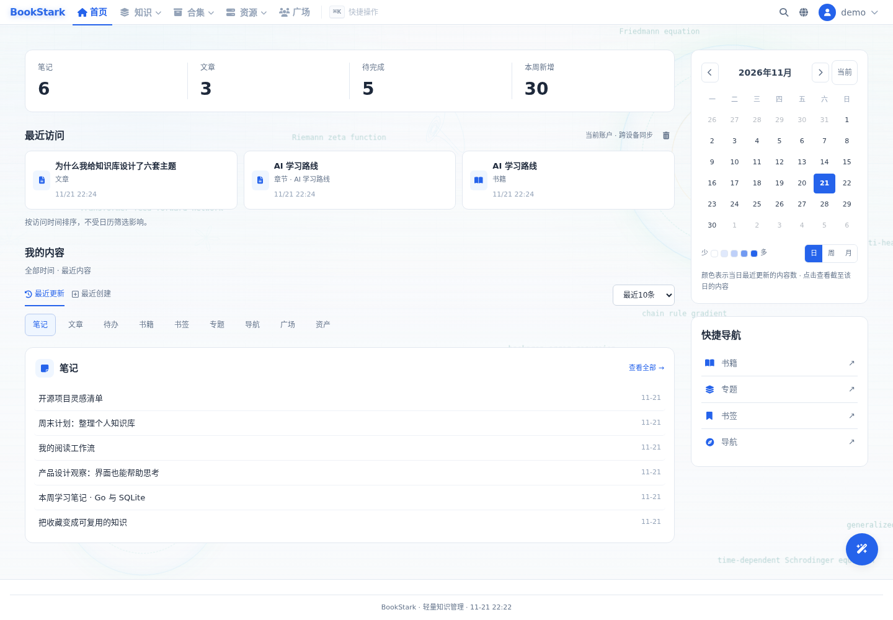</td>
  </tr>
</table>

主题选择保存在当前浏览器，刷新后保留，并支持同一浏览器的跨标签页同步。管理员还可以在「系统设置 → 系统参数 → 外观设置」指定**未登录用户默认主题**：访客已有的浏览器主题偏好优先，已登录用户不受此默认值影响。

## 功能全景

| 你想做什么 | BookStark 提供什么 |
| --- | --- |
| 随时记录与整理 | 速记、文章、Markdown / HTML、标签、置顶、搜索与分享 |
| 建立系统知识 | 书架、书籍、层级文档目录与阅读入口 |
| 围绕问题做研究 | 专题详情、关联资料、小结、待办与评论 |
| 让计划变成行动 | 待办、子任务、完成状态、日期与提醒设置 |
| 留住优质链接 | 书签、标签、导入、批量管理与导航页 |
| 让 AI 帮忙梳理 | 首页助手、文字资料检索、Markdown 总结、笔记与待办草稿确认创建、编辑器辅助 |
| 写文章之外也能创作 | 富文档、电子表格、画板、思维导图、演示文稿，以及无需登录的本机创作工具 |
| 发布自己的内容 | 公开广场、文章/速记/书籍/书签浏览、分享链接与评论 |
| 管理文件和图片 | 图片管理、本地 WebDAV 文件服务、文件上传、浏览与管理 |
| 管理服务器 | 管理员专用的 SSH 资产、网页终端、凭据、远程文件与 Docker 管理 |
| 打造个人门户 | 新闻资讯、电台、世界时钟、友情链接与社交二维码 |
| 维护自己的站点 | 用户管理、统计看板、系统设置、数据导入导出与回收站 |

## 从记录到输出，一条完整的工作流

### 1. 先把想法留下来

打开笔记，把灵感、学习摘要和工作记录写下来。用标签聚类，用日历回看；需要展开时，再写成一篇完整文章。

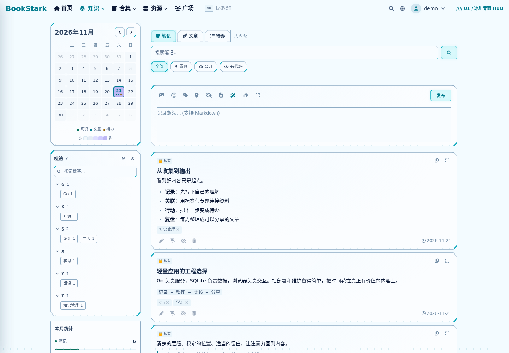

<details>
<summary><strong>展开查看文章列表</strong></summary>

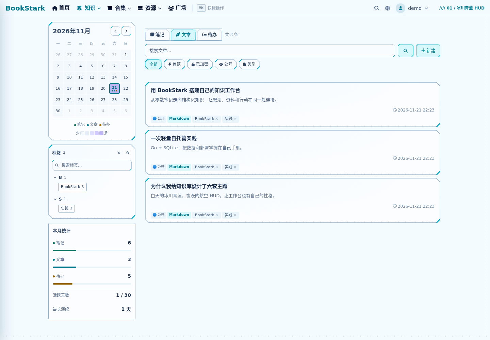

</details>

### 2. 用书籍搭体系，用专题连资料

一本书沉淀长期知识，一个专题推进一个问题。把笔记、文章、文档、书签和待办关联起来，资料、判断与行动都有位置。

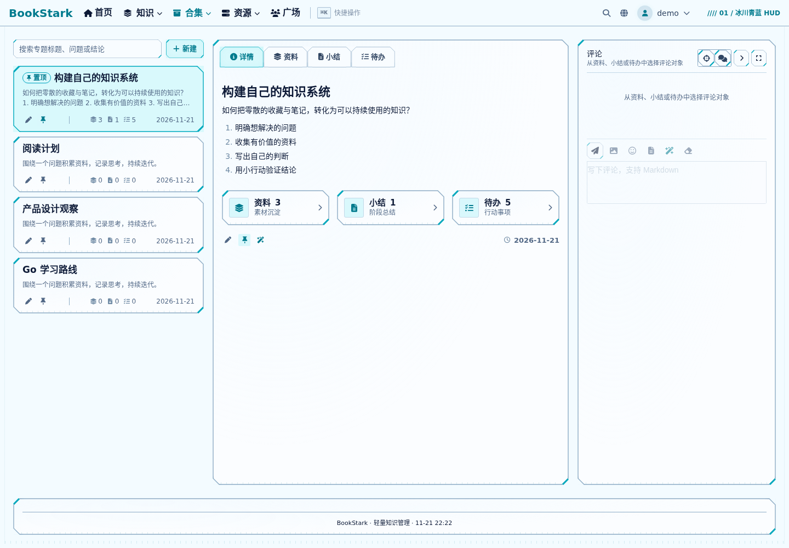

<table>
  <tr>
    <td width="50%"><strong>自己的知识书架</strong><br>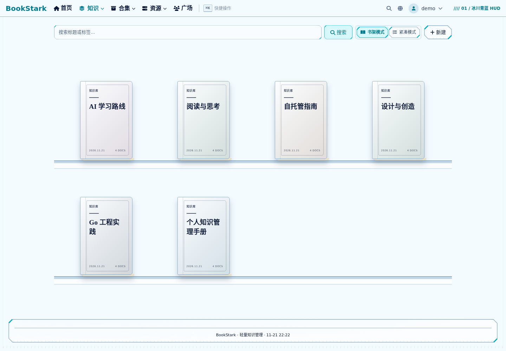</td>
    <td width="50%"><strong>目录与编辑预览</strong><br></td>
  </tr>
</table>

### 3. 让收藏和计划真正用起来

把有价值的链接放进书签，为它写下自己的摘要。再用待办把「以后再看」拆成可以完成的一步。

<table>
  <tr>
    <td width="50%"><strong>书签与标签</strong><br>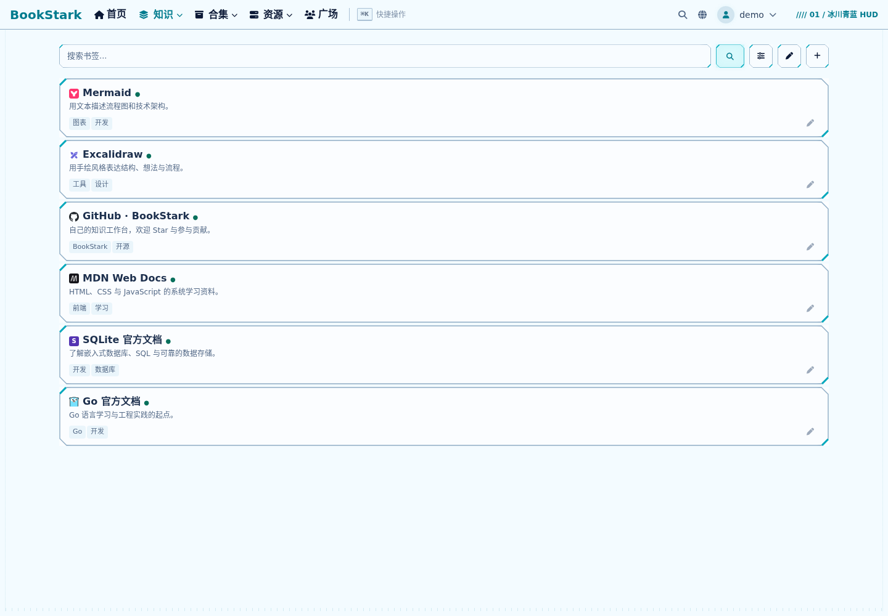</td>
    <td width="50%"><strong>待办与日期</strong><br>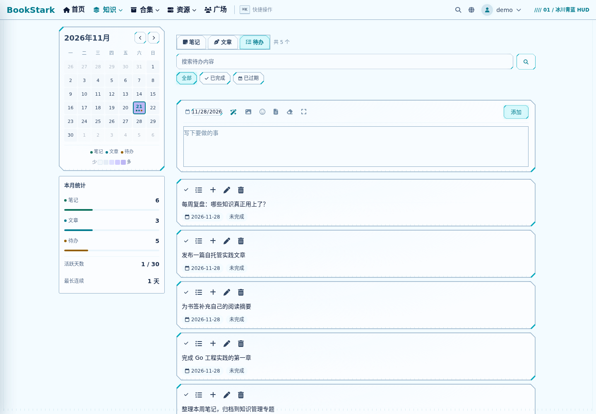</td>
  </tr>
</table>

### 4. 把 AI 带到自己的资料旁边

在首页打开助手，围绕当前账号的资料提问、查找和总结。也可以让它起草一条笔记或待办，**检查草稿、点击确认，再创建记录**。

- 接入支持工具调用的 **OpenAI 兼容接口 / Anthropic 接口**，无需额外向量数据库。
- 流式显示回答和处理进度，支持停止、来源链接与会话恢复。
- 检索范围按账号隔离；当前正文读取支持 Markdown，密码保护内容与服务器凭据不提供给助手。
- AI 服务需自行配置；请求和检索到的相关内容会发往所选服务，调用可能产生费用。


图中展示助手入口与实际面板，不包含模拟的 AI 回答。能力范围与配置细节见 [AI 助手说明](docs/usage-and-deployment.md#首页-ai-助手第一版)。

### 5. 继续创作，也可以分享出去

无需登录也能打开本机创作工具：**Markdown、富文档、电子表格、画板、思维导图、演示文稿**。本机草稿自动保存到当前浏览器，支持导入与导出。


想展示成果？把公开内容汇集到广场，让访客按栏目浏览、搜索与阅读。

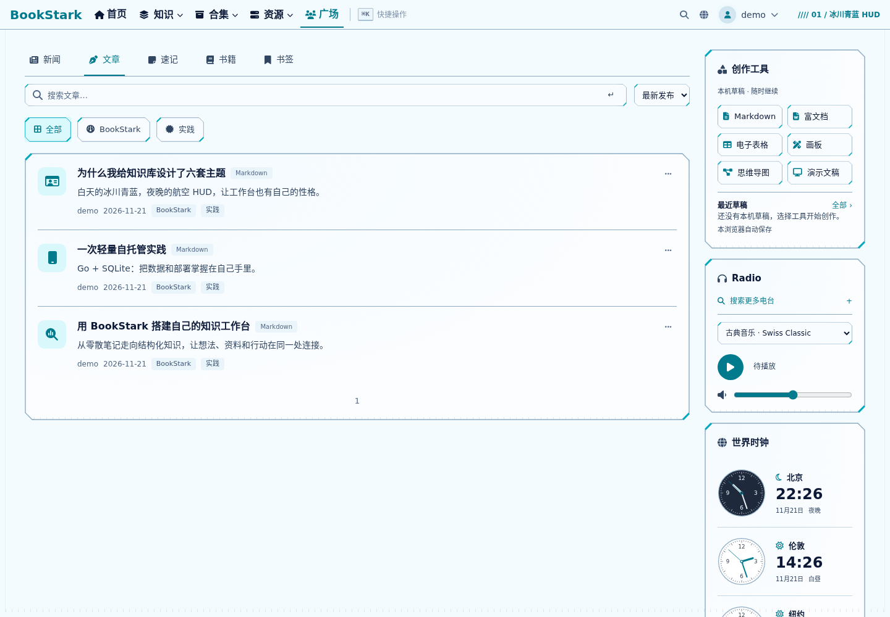

本机草稿与账号内容分开存储，换设备不会自动同步本机草稿。详见 [本机创作工具说明](docs/local-creation-tools.md)。

## 手机，也是一张完整工作台

用手机记录灵感、查看笔记、处理专题。支持 PWA 安装，常用入口可以放到主屏幕。

<p align="center">
  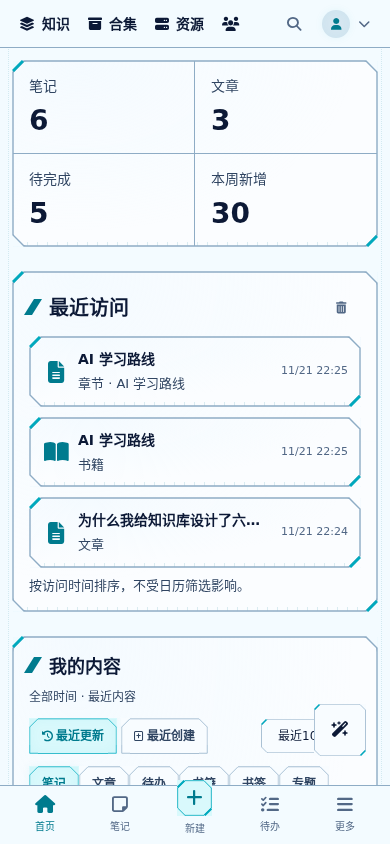
  
  
</p>

PWA 提供静态缓存与部分离线能力；登录、AI、服务器操作等需要网络，并非所有功能都可离线使用。

## 快速部署

**准备 Docker，在自己的机器上从源码启动。** 以下示例使用 Bash、Git 与 OpenSSL，数据持久化到当前目录的 `data/`。

```bash
git clone https://github.com/yunwan1x/bookstark.git
cd bookstark

# 首次生成并保存密钥；后续升级请保留同一份文件。
umask 077
mkdir -p data
cat > data/bookstark.env <<EOF
PORT=8089
MODE=release
TZ=Asia/Shanghai
DB_PATH=/data/bookstark.db
WEBDAV_DB_PATH=/data/bookstark-webdav.db
JWT_SECRET=$(openssl rand -hex 32)
BOOKSTARK_ASSET_SECRET=$(openssl rand -hex 32)
ADMIN_ACCOUNT=admin
ADMIN_PASSWORD=$(openssl rand -hex 16)
EOF

# 构建与启动
DOCKER_BUILDKIT=1 docker build -t bookstark:local .
docker run -d --name bookstark --restart unless-stopped \
  -p 127.0.0.1:8089:8089 \
  --env-file data/bookstark.env \
  -w /data -v "$(pwd)/data:/data" \
  bookstark:local

# 查看首次初始化的管理员密码
sed -n 's/^ADMIN_PASSWORD=//p' data/bookstark.env
```

访问 **http://localhost:8089**，使用 `admin` 和生成的密码登录。远程访问请配置 HTTPS 反向代理，并支持 WebSocket 与 SSE。

也可以使用 [GitHub Releases](https://github.com/yunwan1x/bookstark/releases) 提供的发布产物。完整的 Docker Compose 示例、GHCR 镜像、环境变量、本地运行、升级和备份方法见 [部署与维护手册](docs/usage-and-deployment.md)。根目录现有的 `docker-compose.yml` 用于其他服务，请使用手册中的 BookStark 示例。

> 升级前备份数据库、上传文件与密钥。首次生成的环境文件不要提交到 Git，也不要在升级时重新生成；已有账号密码不会因初始化环境变量改变。

## 技术与开放性

| 层级 | 选择 |
| --- | --- |
| 服务端 | Go + Gin + Go HTML Templates |
| 数据 | SQLite，无需独立数据库服务 |
| 界面 | JavaScript、Tailwind CSS、CSS 变量与共享组件 |
| 分发 | Docker、嵌入式静态资源与模板、发布工作流 |
| 接入 | API Token、WebDAV、OpenAI 兼容 / Anthropic AI 接口 |
| 许可 | Apache License 2.0；第三方组件遵循各自许可 |

[部署与维护](docs/usage-and-deployment.md) · [创作工具](docs/local-creation-tools.md) · [资讯源](docs/news-feeds.md) · [开发约定](CLAUDE.md) · [辅助脚本](scripts/README.md)

## 一起把 BookStark 做得更好

如果 BookStark 正好解决了你的需求，**欢迎点一颗 ⭐ Star**。这是收藏项目最简单的方式，也能帮助更多自托管和知识管理爱好者发现它。

- **试用并反馈**：把使用场景、复现步骤和截图带到 [Issues](https://github.com/yunwan1x/bookstark/issues)。
- **分享你的工作台**：展示主题搭配、知识组织方式或自托管经验。
- **参与贡献**：文档、翻译、功能和问题修复都欢迎；较大的改动建议先在 Issue 中讨论。

### Star 趋势

<a href="https://www.star-history.com/#yunwan1x/bookstark&Date">
  <picture>
    <source media="(prefers-color-scheme: dark)" srcset="https://api.star-history.com/svg?repos=yunwan1x/bookstark&amp;type=Date&amp;theme=dark">
    <source media="(prefers-color-scheme: light)" srcset="https://api.star-history.com/svg?repos=yunwan1x/bookstark&amp;type=Date">
    
  </picture>
</a>

趋势图由 [Star History](https://github.com/star-history/star-history) 提供；加载受其服务与缓存影响，点击图片可查看交互图表。

---

<div align="center">

**让每一次记录，都成为下一次创造的起点。**<br>
[⭐ Star BookStark](https://github.com/yunwan1x/bookstark) · [下载发布版](https://github.com/yunwan1x/bookstark/releases) · [反馈问题](https://github.com/yunwan1x/bookstark/issues)

</div>
